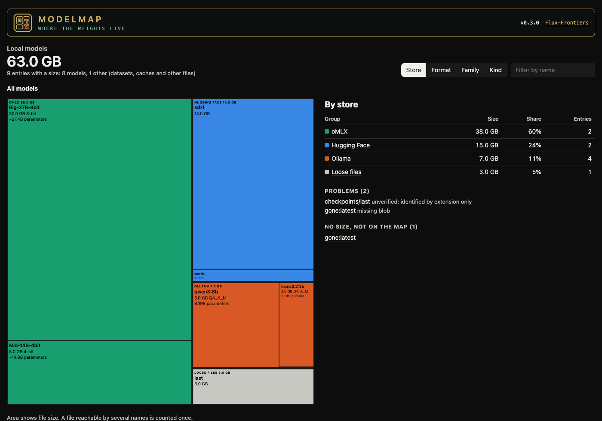

<p align="center">
  
</p>

[](https://github.com/Flux-Frontiers/modelmap/actions/workflows/ci.yml)
[](https://www.python.org/)
[](https://github.com/Flux-Frontiers/modelmap/blob/main/LICENSE)
[](https://github.com/Flux-Frontiers/modelmap/releases)
[](https://python-poetry.org/)
[](https://doi.org/10.5281/zenodo.24520428)
[](https://pre-commit.com/)
[](https://orcid.org/0009-0009-0891-1507)

# modelmap -- Find, Map and Remove Local LLM Models

**See every language-model file on a machine, how much space each one takes, and remove the ones you no longer need.**

modelmap reads the stores of Hugging Face, Ollama, oMLX, LM Studio,
llama.cpp, GPT4All, Jan and Whisper, follows the settings and symlinks
that move them, and sweeps your home folder for loose GGUF, safetensors
and checkpoint files. It reads file headers for parameter counts and
quantization, counts each file once however many names point at it, and
draws everything as a map you can open down to the individual files.



It runs on macOS and Linux with Python 3.10 or later and needs nothing
beyond the standard library.

## Install

```bash
pipx install modelmap      # or: uv tool install modelmap, or: pip install modelmap
```

## Use

```bash
modelmap serve                  # the map in your browser, with a Remove button per model
modelmap map --open             # the map as a file that works offline
modelmap scan                   # totals by store
modelmap list                   # every model, largest first
modelmap providers              # where each store is looked for
modelmap rm ollama:qwen3:4b     # remove a model, after showing what goes and asking
```

On the map, click a tile to open the model; the square is redrawn as its
files, with each file's path and the `modelmap rm` command beside it.
Escape goes back up. Under `modelmap serve`, the panel's Remove button
does what `modelmap rm` does: it shows what will go and asks first.

`modelmap rm` removes Ollama models with `ollama rm`, Hugging Face cache
repositories with `hf cache rm`, and moves anything else to the Trash. It
shows every file or command first, asks, and refuses caches and files
that another model also uses.

To map a machine you cannot reach, ask its owner for an inventory:

```bash
modelmap scan --json --redact > inventory.json     # on their machine
modelmap map --from-json inventory.json --open     # on yours
```

## Documentation

The documentation site is at
[flux-frontiers.github.io/modelmap](https://flux-frontiers.github.io/modelmap/):

- [Guide](https://flux-frontiers.github.io/modelmap/guide/): what is scanned, how sizes are counted, the map,
  serving it, removing models, and the limits.
- [CLI reference](https://flux-frontiers.github.io/modelmap/cli/): every command and option.
- [Cheat sheet](https://flux-frontiers.github.io/modelmap/cheatsheet/): one page.
- [API reference](https://flux-frontiers.github.io/modelmap/api/scanner/): the Python modules.

## Development

```bash
poetry install --with dev,docs
.venv/bin/pytest
poetry run mkdocs serve        # the docs site at http://127.0.0.1:8000
```

## Citation

If you use modelmap in your research or project, please cite it:

> Suchanek, E. G. (2026). *modelmap: Find, Map and Remove Local LLM Models* (Version 0.2.0) [Software]. Flux-Frontiers. https://doi.org/10.5281/zenodo.24520428

```bibtex
@software{suchanek_modelmap,
  author    = {Suchanek, Eric G.},
  title     = {{modelmap}: Find, Map and Remove Local LLM Models},
  version   = {0.2.0},
  year      = {2026},
  publisher = {Flux-Frontiers},
  url       = {https://github.com/Flux-Frontiers/modelmap},
  doi       = {10.5281/zenodo.24520428},
}
```

The DOI is the Zenodo concept DOI, which always resolves to the newest
archived release. The citation metadata is also in [CITATION.cff](https://github.com/Flux-Frontiers/modelmap/blob/main/CITATION.cff). See the
[changelog](https://github.com/Flux-Frontiers/modelmap/blob/main/CHANGELOG.md) for release history.

## License

BSD-3-Clause. See [LICENSE](https://github.com/Flux-Frontiers/modelmap/blob/main/LICENSE).
