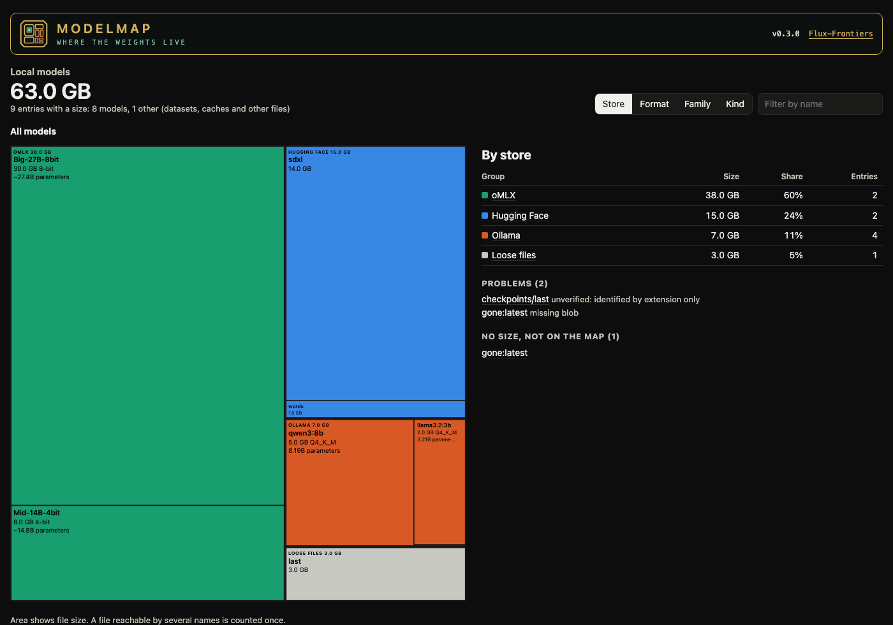
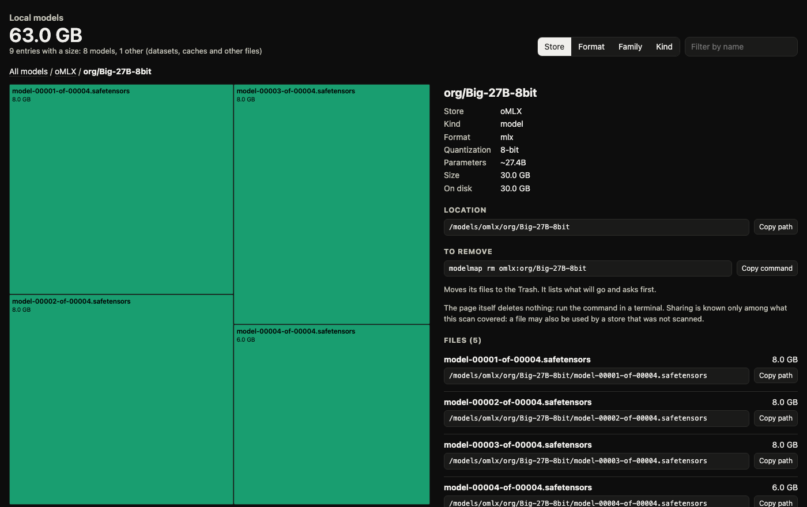

# Guide

modelmap finds the language-model files on a machine, says what each one
is and how much space it takes, draws them as a map, and removes the ones
you choose. This guide explains what it looks at and how it counts. The
[command reference](cli.md) lists every option; the
[cheat sheet](cheatsheet.md) fits on one page.

## What a scan finds

A scan has three parts, run in this order:

1. The stores of the tools below, wherever their settings put them.
2. Any paths you name.
3. A sweep of your home folder, five levels deep, for model files the
   stores do not hold. The sweep runs only when you name no path and no
   store (`--only`), unless you add `--sweep`.

### The stores

| Store | Name in modelmap | Where it is looked for |
|-------|------------------|------------------------|
| Hugging Face cache | `hf` | `HF_HUB_CACHE`, else `HUGGINGFACE_HUB_CACHE`, else `HF_HOME/hub`, else `XDG_CACHE_HOME/huggingface/hub`, else `~/.cache/huggingface/hub`. The Xet cache beside it (`HF_XET_CACHE`, else `HF_HOME/xet`) is shown as one cache entry |
| Ollama | `ollama` | `OLLAMA_MODELS`, else `~/.ollama/models`; on Linux also `/usr/share/ollama/.ollama/models`, where the installer's service keeps them |
| oMLX | `omlx` | `OMLX_MODEL_DIR`, else `model.model_dirs` in oMLX's `settings.json`, else `~/.omlx/models` |
| LM Studio | `lmstudio` | the folder in `~/.lmstudio-home-pointer`, else `~/.cache/lm-studio` if it exists, else `~/.lmstudio`; then its `downloadsFolder` setting, else its `models` folder |
| llama.cpp | `llamacpp` | `LLAMA_CACHE`, else `~/Library/Caches/llama.cpp` (macOS), `%LOCALAPPDATA%\llama.cpp` (Windows) or `~/.cache/llama.cpp` (Linux). Recent llama.cpp downloads go to the Hugging Face cache instead |
| GPT4All | `gpt4all` | the desktop app's download folder, and `~/.cache/gpt4all` for the Python package |
| Jan | `jan` | `JAN_DATA_FOLDER`, else `data_folder` in Jan's `settings.json`, else Jan's data folder; then its `llamacpp/models` and `mlx/models` |
| Whisper | `whisper` | `XDG_CACHE_HOME/whisper`, else `~/.cache/whisper` |
| Anything else | `generic` | the paths you name, and the home sweep |

A store reached through a symlink is followed. `modelmap providers` shows
where each store was looked for, which setting chose the place, and
whether it exists.

### Recognizing a model

modelmap reads file headers, never weights:

- A GGUF file gives its architecture, quantization and exact parameter
  count. A GGUF with no tensors is a tokenizer file and is skipped.
- A safetensors file gives its parameter count. For an MLX model stored
  in 4 or 8 bits, the count is worked out from the quantization in the
  model's `config.json` and shown with a `~`.
- A folder with `config.json` beside safetensors files, or a diffusers
  `model_index.json`, is one model.
- Numbered shards (`model-00001-of-00004.safetensors`) are one model.
- A multimodal projector (`mmproj`) is listed as auxiliary, not as a model.
- A `.pt`, `.pth`, `.bin` or `.ckpt` file of 50 MB or more is listed. One
  that does not start like a PyTorch file is marked unverified.

A scan opens no file it would have to download first: a file that iCloud
Drive or a similar service keeps only in the cloud is listed by size and
not read.

## How sizes are counted

Each file is counted once. When two names lead to one file, as Hugging
Face revisions and Ollama tags often do, the size goes to the first entry
that holds it, and the other entry notes whom it shares with. Totals
therefore match what the disk holds.

Two sizes are kept for each entry: the file size, and the space allocated
on disk. They differ for sparse files. The map uses file size unless you
pass `--disk`.

Ollama tags that point at the same weights are one entry, named for the
first tag, with the rest listed as other names.

## The map

`modelmap map` writes `modelmap.html`, one file that works offline and
loads nothing from the network. A square is divided among everything
found, in proportion to size, with one block per store.



- Click a tile to open it. The square is redrawn as that model's files,
  and the panel beside it lists each file with its full path.
- Click a store's name in the list beside the map, or a tile marked
  "smaller", to see only that store.
- Go back up with Escape, the trail above the map, or the browser's back
  button.
- Group by store, format, family or kind, and filter by name.
- The panel lists every entry with a problem, such as a broken download,
  even when its tile is too small to see.



For each model the panel shows its location, which other entries use the
same files, and the `modelmap rm` command that removes it. The file that
`map` writes deletes nothing; to remove from the page, serve it (next
section).

`modelmap map --svg` writes a static picture of the top level instead.

## Serving the map

`modelmap serve` scans, then serves the same page from your machine and
opens it in a browser. It adds a Rescan button and, in each model's
panel, a Remove button. It runs until you press Ctrl-C.

```bash
modelmap serve                      # scan, serve and open the page
modelmap serve --read-only          # the page without Remove buttons
modelmap serve --no-open --port 8765
```

Remove does what `modelmap rm` does, through the same code. It opens a
dialog listing the command or every path that would go, any Ollama tags
removed with the model, and whether the removal can be undone from the
Trash. Nothing happens until you press Remove in the dialog; Cancel has
the focus, so Enter does not confirm. When you confirm, the server scans
again and plans again. If what would go has changed since the dialog
opened, it removes nothing and shows the new list. After a removal the
page is redrawn from a new scan, at the model's group.

A Remove button appears only where `rm` would act; for a cache or a file
another model uses, the panel says why there is none. One removal runs at
a time.

The server answers only on `127.0.0.1`, only to requests that carry the
token in the address it prints, and only to its own page: a page on
another site cannot read the map or ask it to remove anything. Keep the
address to yourself while the server runs.

`modelmap serve --from-json FILE` serves an inventory read-only: it
describes another machine, or this one at another time.

## Removing models

`modelmap rm` scans, shows everything it would remove, asks, and only
then removes:

```bash
modelmap rm --dry-run ollama:qwen3:4b    # show what would go
modelmap rm ollama:qwen3:4b              # show it, ask, then remove
modelmap rm ~/models/old.gguf --yes      # name by path; --yes skips the question
```

Name a model by the `store:name` that `modelmap list` shows, by an
Ollama tag, or by its path. When two entries share a name, `rm` lists
their paths and removes neither.

How each kind of entry is removed:

- **Ollama**: with `ollama rm`, giving every tag that points at the same
  weights, since Ollama frees the space only when all of them are gone.
  When those tags differ in their settings, for example a longer context
  made with `ollama create`, the plan names them, and with `--yes` each
  must be named on the command line. `ollama rm` acts on the Ollama that
  is running, so modelmap refuses a copy of an Ollama store kept elsewhere,
  an `OLLAMA_HOST` that names another machine, and an Ollama whose tags
  have the same names but other manifests (it uses another models folder).
  A removal counts only when Ollama no longer lists the tags and the
  scanned store no longer holds them.
- **Hugging Face cache**: with `hf cache rm`, which the `hf` command
  provides.
- **Everything else**: moved to the Trash (`trash` on macOS, `trash` or
  `gio trash` on Linux). A model folder moves whole, and is refused when it
  also holds anything that is not part of the model, such as a `.git`
  checkout. Loose files move one by one.

These are refused, and nothing is removed:

- caches, which their tools rebuild;
- files nothing refers to; for the Hugging Face cache, `hf cache prune`
  removes those;
- an entry whose files another entry also uses, in either direction: a
  file linked into another store, or a repository that a file elsewhere
  links into.

When one of several targets is refused, none is removed. Space moved to
the Trash is freed when the Trash is emptied.

## Looking at another machine

Ask the machine's owner to make an inventory, and map it on yours:

```bash
modelmap scan --json --redact > inventory.json     # on their machine
modelmap map --from-json inventory.json --open     # on yours
```

`--redact` replaces the home folder with `~` everywhere, including in
model names, and drops the machine's name. An inventory is read as it is,
so redact it when you make it; `--from-json` refuses scan options.

## Limits

- Which entries share a file is known only among what the scan covered.
  After `--only` or `--no-defaults`, a file can show no other user and
  still have one in a store that was not scanned.
- A copy-on-write clone (APFS, Btrfs) shares space with its original in a
  way a scan cannot see, so totals can be higher than the space used.
- The first scan after a restart is slower, because the home folder is
  not yet in the file cache.
- modelmap runs on macOS and Linux. Windows locations are known but
  untested.
