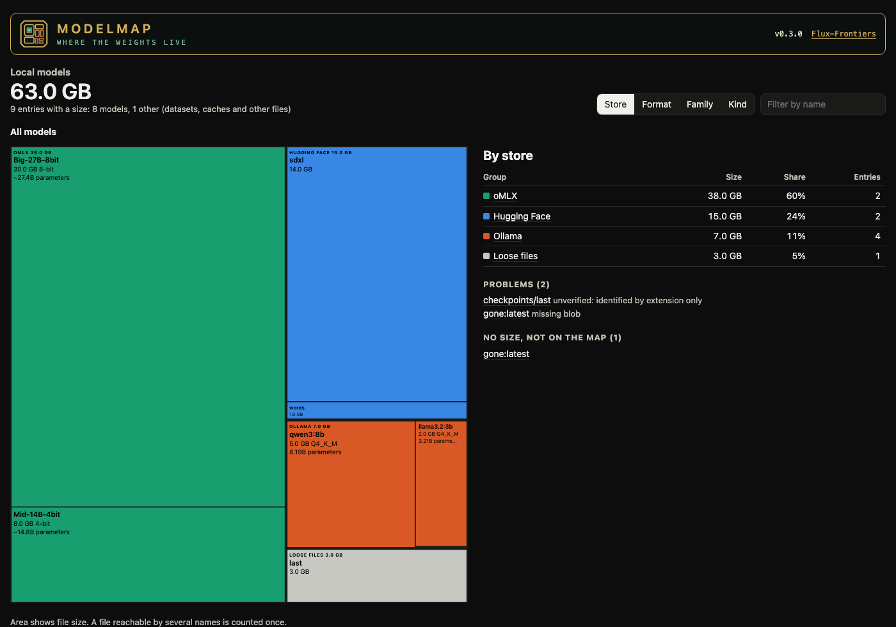

# modelmap

modelmap finds the language-model files on a machine, says what each one
is and how much space it takes, draws them as a map, and removes the ones
you choose.

It reads the stores of Hugging Face, Ollama, oMLX, LM Studio, llama.cpp,
GPT4All, Jan and Whisper where those tools keep them, including after
settings that move them, and sweeps your home folder for loose GGUF,
safetensors and checkpoint files. Each file is counted once, however many
names point at it.



## Install

modelmap needs Python 3.10 or later and nothing beyond the standard
library. It runs on macOS and Linux.

```bash
pipx install modelmap      # or: uv tool install modelmap, or: pip install modelmap
```

## Use

```bash
modelmap serve                  # the map in your browser, with a Remove button per model
modelmap map --open             # the map as a file that works offline
modelmap scan                   # totals by store
modelmap list                   # every model, largest first
modelmap rm ollama:qwen3:4b     # remove a model, after showing what goes and asking
modelmap providers              # where each store is looked for
```

## Where to go next

- [Guide](guide.md): what is scanned, how sizes are counted, the map,
  removing models, and the limits.
- [CLI reference](cli.md): every command and option.
- [Cheat sheet](cheatsheet.md): one page.
- [Mac app](mac.md): the map in its own window, with help for removing
  models from it.
- [API reference](api/scanner.md): the Python modules, for using modelmap
  from code.

modelmap is part of [Flux-Frontiers](https://github.com/Flux-Frontiers).
It is BSD-3-Clause licensed; cite it with the Zenodo DOI
[10.5281/zenodo.24520428](https://doi.org/10.5281/zenodo.24520428).
